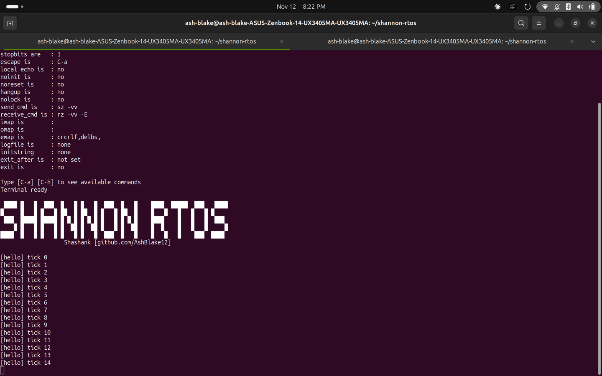
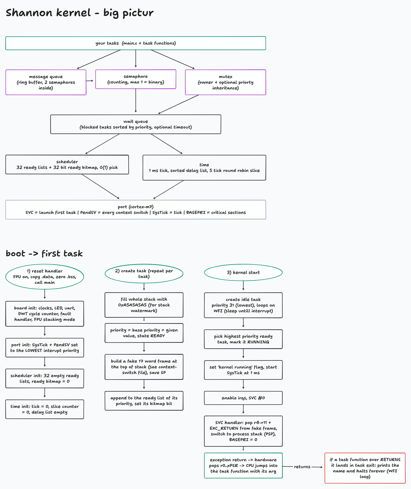
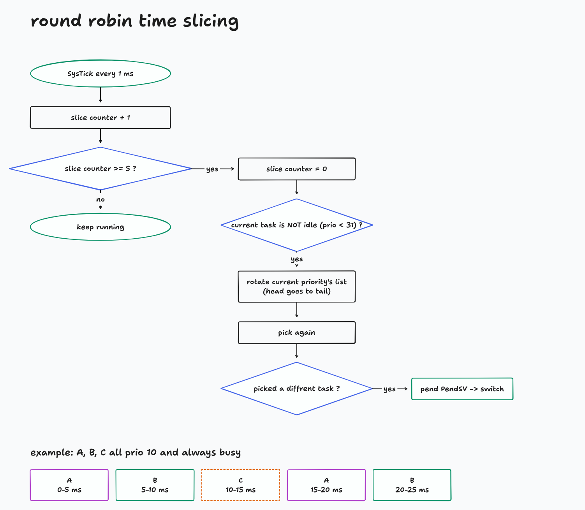

# Shannon RTOS

```
 ████ █   █  ███  █   █ █   █  ███  █   █    ████  █████  ███   ████
█     █   █ █   █ ██  █ ██  █ █   █ ██  █    █   █   █   █   █ █
 ███  █████ █████ █ █ █ █ █ █ █   █ █ █ █    ████    █   █   █  ███
    █ █   █ █   █ █  ██ █  ██ █   █ █  ██    █  █    █   █   █     █
████  █   █ █   █ █   █ █   █  ███  █   █    █   █   █    ███  ████
```



Shannon RTOS is a real-time operating system (RTOS) with an emphasis on small footprint and determinism. Its a preemptive priority kernel for the Cortex-M7, written from scratch, no HAL, no libc.

For brevity, many parts of the documentation will refer to Shannon RTOS as simply Shannon.

## Getting Started

Currently only runs on the **NUCLEO-H7A3ZI-Q** (STM32H7A3, Cortex-M7). you need:

- `arm-none-eabi-gcc` (tested 10.3-2021.10)
- `openocd` + st-link
- serial terminal @ 115200 on the stlink vcp

```
git clone https://github.com/AshBlake12/shannon-rtos
cd shannon-rtos
make
make flash
```

You should see the banner and the led blinking. thats it.

## Features (v0.1)

- preemptive priority scheduler, 32 levels, O(1) pick (clz on a bitmap)
- round robin time slicing for same prio tasks
- task sleep + timeouts, wraparound safe tick math
- semaphores, mutexes (optional priority inheritance), message queues
- isr safe give/send with K_NO_WAIT
- FPU context switching
- fault handler that actually tells u where it crashed
- DWT cycle counter timing

## Diagrams





more in `docs/diagrams/` (open the `.tldraw` files in tldraw office).

## Directory Structure

```
arch/     cortex-m7 port, context switch, faults, fpu
bsp/      startup, linker script, clocks, uart, timers
kernel/   scheduler, tasks, time, wait queues, sync + ipc
lib/      kprintf
docs/     datasheets / ref manuals
main.c    demo, put ur tasks here
```

## Documentation

no real docs yet lol. read the headers in `kernel/`, theyre mostly commented. `docs/` has the ST reference manual and datasheet.

## Inspiration

inspired from parts of FreeRTOS and NuttX. big shoutout to Quantum Leaps (Miro Samek), learned a ton from there.

**flip you zephyr**

## Contributing

open an issue or PR. keep it C, keep it small.

## License

MIT, see [LICENSE](LICENSE).
